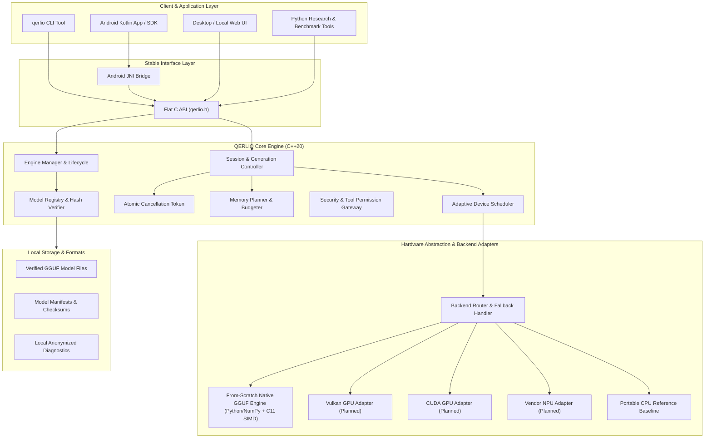
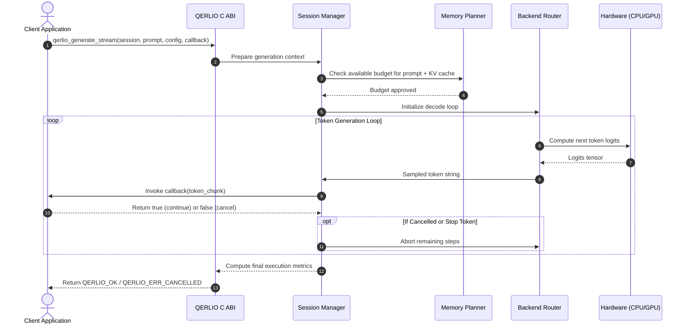

# QERLIO Runtime — System Architecture & Component Design

**Owner:** ZAQERIS AI Research Group  
**Document Version:** 1.0  
**Date:** 2026-11-19  

---

## 1. High-Level Architectural Diagram

---

## 2. Component Responsibilities

### 2.1 Engine Manager (`qerlio_engine_t`)
- Manages global state, logger initialization, and device discovery.
- Thread-safe coordinator for active models and sessions.
- Enforces single-instance or bounded multi-instance memory limits.

### 2.2 Model Registry & Verifier (`qerlio_model_t`)
- Reads GGUF metadata headers without loading full tensors into memory.
- Verifies SHA-256 against expected hash.
- Validates tensor counts, quantization schemes, and architecture compatibility.
- Enforces strict memory budgets before tensor allocation.

### 2.3 Session Manager & Cancellation Token (`qerlio_session_t`)
- Allocates thread-safe execution context for generation.
- Binds an atomic cancellation flag checked before each token step.
- Manages KV Cache lifecycle, context window rolling, and prompt evaluation.
- Emits chunks via user-supplied token callback.

### 2.4 Backend Router & Fallback Controller
- Evaluates device capabilities (CPU vector extensions, available memory, driver versions).
- Directs model execution to the optimal verified backend.
- Automatically and gracefully falls back to CPU reference execution if GPU/NPU initialization fails.

---

## 3. Data Flow during Streaming Generation

